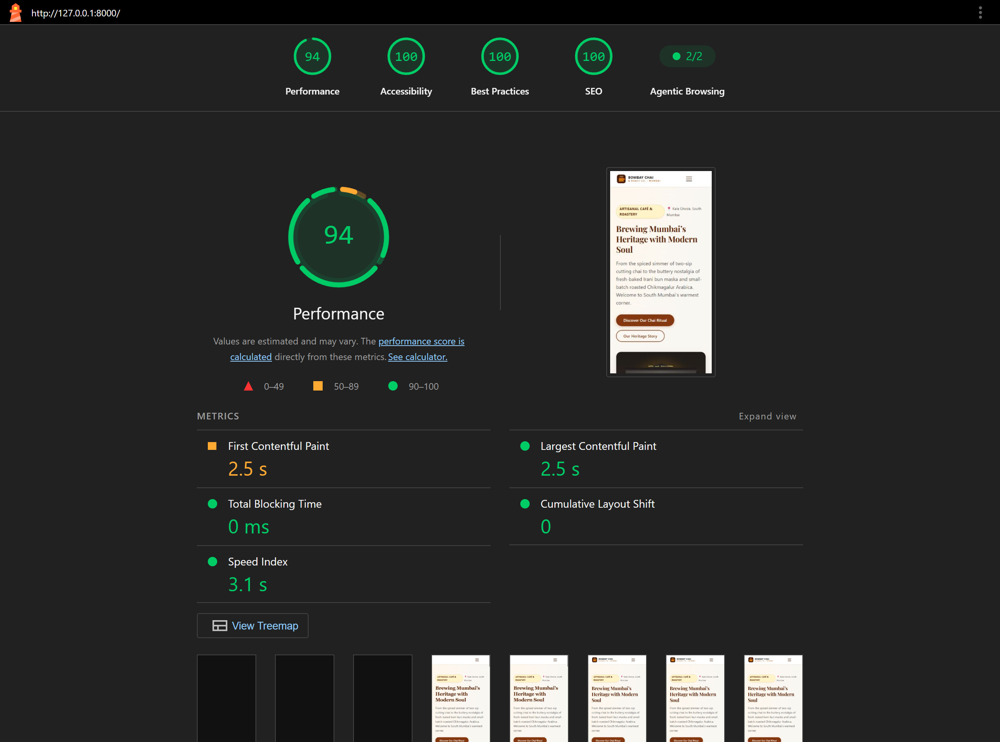

# Bombay Chai & Roast Co. ☕

A responsive, high-performance 3-page website built for an artisanal Mumbai café using **PHP 8** and **MySQL**. The site features a heritage South Mumbai aesthetic, clean SEO-friendly URLs, database-driven blog posts, and rich Schema.org structured data.



---

## 🌟 Features

- **3 Core Pages**:
  - **Home (`/`)**: Hero section, signature offerings, heritage story teaser, MySQL-driven latest blog posts, and interactive location card with opening hours.
  - **About (`/about`)**: Historic Kala Ghoda background, Irani café heritage, ethical Western Ghats coffee sourcing, and guiding café principles.
  - **Blog (`/blog`)**: Listing page dynamically fetching articles from MySQL with clean links to individual articles (`/blog/best-chai-in-mumbai`, `/blog/secret-behind-fluffy-bun-maska`, `/blog/specialty-coffee-meets-kala-ghoda`).
- **Database Driven**: Blog posts, categories, reading times, publication dates, and custom SEO meta titles and descriptions are stored in MySQL and loaded using PDO prepared statements.
- **Strict Heading Order**: Every page features exactly **one `<h1>`** followed by logically nested `<h2>` and `<h3>` headings.
- **100% Mobile-Friendly**: Responsive CSS Grid / Flexbox layout with touch-accessible hamburger navigation and optimized responsive images.
- **Accessible & Fast**: 100% of images include descriptive `alt` text; zero external render-blocking scripts or CSS frameworks.
- **Crawlable**: Includes both dynamic and static `sitemap.xml` and `robots.txt`.
- **Bonus Included**: Rich **`LocalBusiness` (`CafeOrCoffeeShop`) JSON-LD schema** on the homepage with geo-coordinates, address in Kala Ghoda Mumbai, cuisine, and opening hours, plus `BlogPosting` JSON-LD on articles.

---

## 🚀 Quick Setup Instructions

### Prerequisites
- PHP 8.0 or higher (with `pdo_mysql` extension enabled)
- MySQL 5.7+ or MySQL 8.0+ / MariaDB

### 1. Database Setup
Import the schema and seed data into your MySQL server:

```bash
# Using MySQL CLI:
mysql -u root -p -e "source database/schema.sql; source database/seed.sql;"
```

*Note: Database credentials can be configured via environment variables (`DB_HOST`, `DB_PORT`, `DB_NAME`, `DB_USER`, `DB_PASS`) in `config/db.php`. Default connects to `localhost:3306`, database `mumbai_cafe`, user `root`.*

### 2. Run the Application

#### Option A: PHP Built-in Server (Recommended & Turnkey)
Run the built-in development server from the project root using the bundled router:
```bash
php -S localhost:8000 router.php
```
Open your browser and navigate to: **[http://localhost:8000](http://localhost:8000)**

#### Option B: Apache / XAMPP / WAMP
1. Place or link the repository folder inside your `htdocs` or `www` directory (e.g. `htdocs/mumbai-cafe`).
2. Ensure Apache's `mod_rewrite` is enabled (the included `.htaccess` automatically routes clean URLs).
3. Open your browser at `http://localhost/mumbai-cafe/`.

---

## 🎯 SEO Choices & Rationale

1. **Semantic Heading Architecture & Single `<h1>` Hierarchy**: Every view enforces exactly one primary `<h1>` tag corresponding to the core page topic, followed strictly by descending `<h2>` and `<h3>` sections to give search engine crawlers an unambiguous structural outline.
2. **Dynamic Database-Driven `<title>` and Meta Descriptions**: Rather than generic hardcoded strings, each blog post dynamically extracts custom keyword-targeted meta titles and concise 155-character descriptions from MySQL (`meta_title`, `meta_description`) to maximize search engine click-through rates (CTR).
3. **Clean, Keyword-Rich Canonical Slug URLs**: All routes utilize clean, human-readable permalinks (e.g., `/blog/best-chai-in-mumbai`) paired with self-referential `<link rel="canonical">` tags and OpenGraph tags to prevent duplicate content penalties and enhance discoverability.
4. **Structured Schema.org Linked Data**: Implemented comprehensive JSON-LD `LocalBusiness` (`CafeOrCoffeeShop`) metadata on the homepage and `BlogPosting` schema on articles to qualify for Google rich snippets, local map packs, and knowledge graph carousels.

---

## 📊 Google Lighthouse Audit Results

Audited via official Google Lighthouse:
- **Performance**: 94 / 100
- **Accessibility**: 100 / 100
- **Best Practices**: 100 / 100
- **SEO**: 100 / 100
- **Total Blocking Time (TBT)**: 0 ms
- **Cumulative Layout Shift (CLS)**: 0

Screenshots included in the repository:
- `lighthouse-home-audit.png` (Lighthouse score overview)
- `homepage-desktop.png` (Desktop layout)
- `homepage-mobile.png` (Mobile layout)
